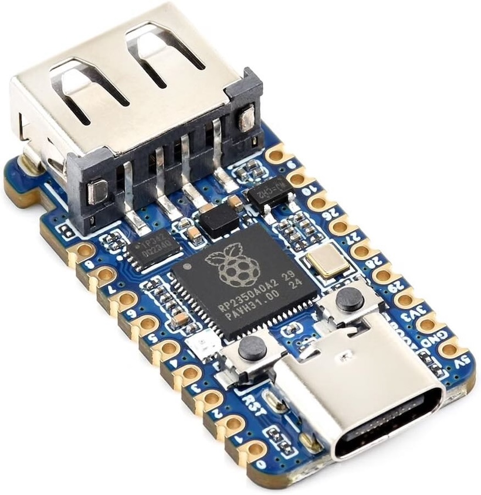

# Torino

Torino is firmware for the Waveshare [RP2350-USB-A](https://www.waveshare.com/wiki/RP2350-USB-A) board to spoof a Mustang II V.2 as a Mustang LT25 for Fender Tone LT Desktop software. It works by translating between the LT and Mustang USB protocols and allows control of the old Mustang DSP from Fender Tone without modifying the amplifier firmware.

I only tested it with my Mustang II V.2 on macOS, but I don't see why it wouldn't work with all versions of the old Mustang and the Windows version of Tone.

## Hardware

Waveshare RP2350-USB-A board with 2 MB of flash.



The build uses the Pico SDK’s `pico2` board preset to compile for the RP2350 chip, which is evidently compatible with the Raspberry Pi Pico 2.

## Build

### Deps

The build needs `CMake` and `picotool`, and the Pico SDK requires Python 3. The build script in the `scripts` directory downloads a pinned ARM GCC toolchain, the Pico SDK, and Pico-PIO-USB into `target/` on the first run.

```sh
bash scripts/build.sh
```

The built firmware image is stored at `target/build/torino.uf2`. On other platforms, set `ARM_GCC_ROOT` to an installed ARM bare-metal GCC toolchain directory. If `picotool` is not in `PATH`, point the `PICOTOOL` environment variable to the binaries.

## Flash and use

### Manual

1. Hold the board's BOOT button and connect it to USB-C.
2. Copy target/build/torino.uf2 to the board's bootloader volume.
3. Wait for the board to restart and the volume to disappear.

### With a script

1. Hold the board's BOOT button and connect it to USB-C.
2. Run `picotool info -a` to find the board's serial number.
3. On macOS, use `diskutil list` to identify the board's bootloader volume.
4. Run `diskutil unmount /Volumes/<bootloader-volume>` with that volume's actual path. Do not eject the USB device.
5. Run `bash scripts/flash.sh <board-serial> target/build/torino.uf2` with the board's actual serial number.
6. Wait for the script to finish. It verifies the firmware before it restarts the board.

After that, you are done. Connect the amplifier to the board's USB-A port, open Fender Tone LT Desktop, and let it sync and find the amp.

There is no direct match between the amp models and effects in the Mustang II and Mustang LT25, so the firmware just ignores attempts to load them from Tone or drops them from factory presets.

The firmware maps supported LT amp models and effects to their Mustang equivalents, though some controls are approximations and the sound can differ. Unsupported selections ignored and for factory presets the firmware removes unsupported effects and substitutes a fallback for unsupported amp models.

## Tests

The C tests cover control mappings, preset serialization, and Tone protocol handling. They do not access USB hardware or require the Pico SDK.

```sh
cmake -S . -B target/tests -DTORINO_TESTS=ON
cmake --build target/tests
ctest --test-dir target/tests --output-on-failure
```

## Name

Mustang, Torino... See? Nevermind.
